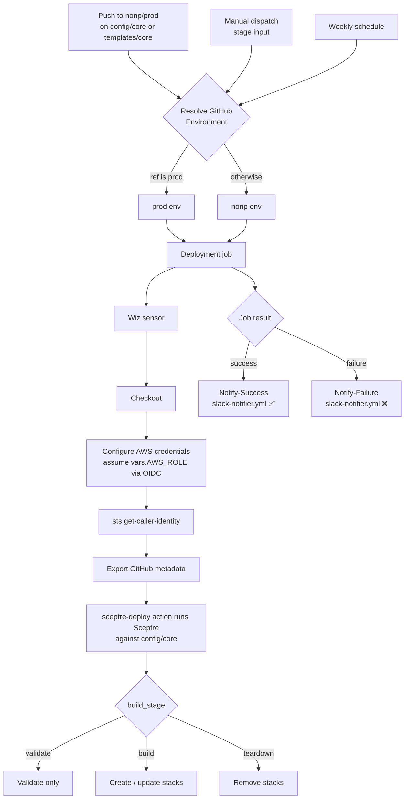

# AWS Identity Management

> **Sanitized example.** This repository is a generalized, sanitized version of a real
> implementation. Account IDs, group names, permission set names, organization identifiers and
> external references (for example the `your-org/shared-actions/aws/sceptre-deploy@v1` action,
> the `@your-org/...` CODEOWNERS teams and the `your-org/aws-identity-management` repository check in the
> drift-detection template) are placeholders you must replace with your own. It is provided as-is,
> without warranty, under the MIT license.

This repository manages **AWS IAM Identity Center (SSO)** for an AWS Organization. It defines, as code, the permission sets that exist in the
organization and the assignments that grant Identity Center groups access to AWS accounts.

Everything is deployed declaratively through CloudFormation (generated and orchestrated by
[Sceptre](https://docs.sceptre-project.io/)) and applied automatically by GitHub Actions.

| Setting        | Value                     |
| -------------- | ------------------------- |
| Project code   | `aws-identity-management` |
| AWS region     | `ca-central-1`            |
| Org role scope | `org-prod`              |

## Repository layout

```text
.
├── config/                  # Sceptre configuration tree  ──► see config/README.md
│   ├── config.yaml          # Global Sceptre config (project_code, region, shared stack_tags)
│   ├── core/                # Core SSO components & common assignments  ──► see config/core/README.md
│   ├── nonp/            # Nonp-environment assignments (separate StackGroup)  ──► see config/nonp/README.md
│   └── prod/              # Production per-account assignments (StackGroup)  ──► see config/prod/README.md
│       └── product/         # Product-specific permission sets (sub-group)
├── templates/
│   ├── core/                # CloudFormation / troposphere templates used by config/core
│   ├── product/             # Product-specific permission-set templates used by config/prod/product
│   └── assignments.yaml.j2  # Template used by the nonp and prod assignment stacks
├── drift-detection/         # Docs for the drift-detection stack  ──► see drift-detection/README.md
├── iam-validator-config.json    # Config consumed by the IAM Validator workflow (see below)
└── .github/
    ├── workflows/
    │   ├── core-deployment.yml       # Core deployment pipeline (push to nonp/prod)
    │   ├── nonp-deployment.yml   # Nonp deployment pipeline (push to nonp)
    │   ├── prod-deployment.yml     # Prod deployment pipeline (merged PR into prod)
    │   ├── validate-iam.yml          # IAM Validator — PR check for IAM policy changes (see below)
    │   └── slack-notifier.yml        # Reusable workflow that posts a Slack message (called by all pipelines)
    ├── CODEOWNERS                    # Required reviewers (Cloud Platform + Security teams)
    └── ISSUE_TEMPLATE/           # Bug / feature / improvement issue forms
```

> **Note:** The detailed inventory of permission sets, group assignments, and the templates that
> back them lives in [config/core/README.md](config/core/README.md). The top-level document only
> covers how the repository is structured and how deployments are run.

## How deployment works (GitHub Actions)

Deployment is split into **path-scoped** pipelines so that a change to one StackGroup does not
redeploy the others:

| Workflow | Triggers | Environment | Deploys StackGroup |
| -------- | -------- | ----------- | ------------------ |
| [`Core Components and Common Assignments - Deploy`](.github/workflows/core-deployment.yml) | **Push** to `nonp` or `prod` touching `config/core/**` or `templates/core/**`; weekly schedule; manual dispatch | `prod` when run from `prod`, otherwise `nonp` | `config/core/` |
| [`Nonp Assignments - Deploy`](.github/workflows/nonp-deployment.yml) | **Push** to `nonp` touching `config/nonp/**` or `templates/assignments.yaml.j2`; weekly schedule; manual dispatch | always `nonp` | `config/nonp/` |
| [`Prod Assignments - Deploy`](.github/workflows/prod-deployment.yml) | **Merged PR** into `prod` touching `config/prod/**`, `templates/product/**` or `templates/assignments.yaml.j2`; weekly schedule; manual dispatch | always `prod` | `config/prod/` |

The pipelines share the same steps (Wiz sensor, checkout, AWS OIDC role assumption, sceptre-deploy
deploy, Slack notification) but **differ in triggers and environment resolution**, as shown above.
Notably, the prod pipeline has no `push` trigger (it runs when a PR is closed *and merged*), and
only the core pipeline picks its environment dynamically. The sections below describe the core
pipeline unless noted.

Changes are also gated by [`.github/CODEOWNERS`](.github/CODEOWNERS): the Cloud Platform and
Cloud Platform Security teams must review everything, and `config/core/` and `templates/core` are
owned by the Security team.

**Drift Detection:** The core pipeline deploys the [CloudFormation drift detection](drift-detection/README.md)
stack (`config/core/drift-detection.yaml`), which detects manual or unexpected changes to deployed stacks.

None of the pipelines run CloudFormation directly — they hand the work to a shared
**sceptre-deploy** action (`your-org/shared-actions/aws/sceptre-deploy@v1`), which wraps Sceptre
to validate, build, or tear down the stacks in the targeted StackGroup.

After the deployment job finishes, each pipeline calls the reusable
[`slack-notifier.yml`](.github/workflows/slack-notifier.yml) workflow to post a **Slack
notification** — a success message when the deployment job succeeds, or a failure message when it
fails (see [Slack notifications](#slack-notifications) below).



### What triggers a deployment

The core workflow runs on these events:

1. **Push** to `nonp` or `prod` — but only when files under `config/core/**` or
   `templates/core/**` change. This is the normal path: merge to `nonp` deploys to the
   nonp environment, merge to `prod` deploys to the prod (production) environment.
2. **Scheduled** — weekly on Sunday nights ET (cron `0 4 * * 1`, Monday 04:00 UTC). Scheduled runs
   execute on the default branch.
3. **Manual dispatch** (`workflow_dispatch`) — lets an operator run the pipeline on demand and
   pick the stage (see below). The environment follows the branch the workflow is run from.

The core workflow also listens for a **closed pull request** against `prod`, but that event does
not start the deployment job on its own — the merge's resulting push to `prod` does. In the
**prod** pipeline the merged-PR event *is* the deployment trigger (there is no push trigger).

### Environments

The job binds to a GitHub **Environment**, which is where the AWS role and SSO instance values
come from. There is no `environment` input. For the core pipeline it is resolved from the ref:

| Trigger                                    | Environment selected |
| ------------------------------------------ | -------------------- |
| Core: run on `prod` (push, or manual run from `prod`) | `prod` |
| Core: any other ref (push to `nonp`, manual run from another branch) | `nonp` |
| Nonp pipeline                          | always `nonp`    |
| Prod pipeline                            | always `prod`      |

### Deployment stages

A **stage** input (manual runs only) is passed to sceptre-deploy/Sceptre as `build_stage`:

- **`validate`** – validate the templates and configuration without applying changes.
- **`build`** – create/update the stacks (the actual deployment). This is the default.
- **`teardown`** – remove the stacks.

> **Known limitations:**
> - The deployment job only runs when the manual stage is `build`, or on a push / merged PR /
>   schedule trigger. Manually selecting `validate` or `teardown` therefore **skips the job**
>   rather than running that stage.
> - On pushes (core, nonp) and merged PRs (prod) the stage is forced to `build`. On
>   **scheduled** runs no stage input exists, so `build_stage` resolves to `validate` — the weekly
>   run validates but does not apply changes.

### Pipeline steps

1. **Wiz sensor** (`wiz-sec-public/wiz-sensor-github-action`) using `WIZ_SENSOR_TOKEN`.
2. **Checkout** the repository.
3. **Print `AWS_ROLE`** (echoes `vars.AWS_ROLE` to the log).
4. **Configure AWS credentials** via `aws-actions/configure-aws-credentials`, assuming the role
   in `vars.AWS_ROLE` (OIDC, 7200‑second / 2‑hour session, region `ca-central-1`).
5. **Verify the role** with `aws sts get-caller-identity`.
6. **Export GitHub metadata** (repository, branch, actor, short commit, commit author/message,
   run ID) as env vars; branch and repository feed the stack tags in
   [`config/config.yaml`](config/config.yaml).
7. **Deploy** with the sceptre-deploy action (`app-name: aws-identity-management`), passing the pipeline's
   environment (`core`, `nonp`, or `prod`) and the resolved `build_stage`. sceptre-deploy runs
   Sceptre against the matching `config/<group>/` directory.
8. **Notify Slack** — once the deployment job completes, `Notify-Success` (on success) or
   `Notify-Failure` (on failure) calls the reusable `slack-notifier.yml` workflow to post the
   result to Slack.

### Slack notifications

All three pipelines end with two notification jobs that depend on the deployment job:

| Job | Runs when | Status posted |
| --- | --------- | ------------- |
| `Notify-Success` | the deployment job succeeded (`if: success()`) | `SUCCESS ✅` |
| `Notify-Failure` | the deployment job failed (`if: failure()`) | `FAILED ❌` |

Both call the reusable [`slack-notifier.yml`](.github/workflows/slack-notifier.yml) workflow
(`uses: ./.github/workflows/slack-notifier.yml`), which posts a Block Kit message to a Slack
incoming webhook. The message reports the repository, workflow, branch, **environment** (`core`,
`nonp`, or `prod` depending on the pipeline), commit (linked), author, a status message, and
a **View Workflow** button linking back to the run. The webhook URL is supplied via the
`SLACK_WEBHOOK` secret passed from the calling workflow; the environment is passed as the
`environment` input from the calling job.

### Required Environment configuration

Each GitHub Environment (`nonp`, `prod`) must provide the following. These are referenced by
the workflow and consumed by the templates at deploy time.

**Variables (`vars`)**

| Name             | Purpose                                              |
| ---------------- | ---------------------------------------------------- |
| `AWS_ROLE`       | ARN of the IAM role the pipeline assumes in the org-prod account. |
| `SSOINSTANCEID`  | IAM Identity Center (Identity Store) instance ID.    |
| `SSOINSTANCEARN` | IAM Identity Center instance ARN.                    |
| `ORGID`          | AWS Organization ID (used by the IAM validator; see below). |

**Secrets (`secrets`)**

| Name                | Purpose                                  |
| ------------------- | ---------------------------------------- |
| `DEPLOY_APP_ID`   | App ID used to authenticate the sceptre-deploy action. |
| `DEPLOY_APP_KEY`  | App key used to authenticate the sceptre-deploy action. |
| `SLACK_WEBHOOK`     | Slack incoming webhook URL used by the `Notify-Success` / `Notify-Failure` jobs (and passed to the drift-detection stack by the core pipeline). |
| `WIZ_SENSOR_TOKEN`  | Token for the Wiz GitHub Actions sensor. |

## IAM policy validation (PR check)

In addition to the deployment pipelines, [`validate-iam.yml`](.github/workflows/validate-iam.yml)
runs [`cfn-policy-validator`](https://github.com/awslabs/aws-cloudformation-iam-policy-validator) against any
CloudFormation templates changed in a pull request, to catch overly-permissive or unintended IAM
policy changes (e.g. new external principals) before they merge.

Only files under `templates/core/**` and `templates/product/**` (plus any `.json` under
`templates/`) are considered — these are the actual CloudFormation templates that define IAM
permission sets. Sceptre stack configs under `config/**` are intentionally excluded: they aren't
CloudFormation templates (no `Resources:`/IAM policies) and would just fail validation.

### Triggers

- **Pull request** targeting `prod` that touches `templates/core/**.yaml`,
  `templates/product/**.yaml`, or `templates/**.json` — validates only the templates changed in
  the PR.
- **Manual dispatch** (`workflow_dispatch`) — run on demand from the Actions tab; validates **all**
  matching templates in the repo, regardless of whether they changed, since there's no PR diff to
  scope against.

### What it does

1. Checks out the full Git history (`fetch-depth: 0`) so changed files can be diffed accurately.
2. Assumes the org role (`vars.AWS_ROLE`) via OIDC and confirms it with `sts get-caller-identity` —
   `cfn-policy-validator` runs under this same assumed-role session.
3. Installs `cfn-policy-validator` and `jq`.
4. Builds the list of templates to validate:
   - On a **pull request**, uses `tj-actions/changed-files` to find only the changed templates
     under `templates/core/**/*.yaml`, `templates/product/**/*.yaml`, and `templates/**/*.json`.
   - On a **manual run**, globs for every file matching those same patterns, changed or not.
5. Builds the `--parameters` values every template might reference. `cfn-policy-validator`
   **ignores a template's own `Default`** and errors (`No value passed for referenced
   parameter`) unless every referenced parameter is passed explicitly, so all of them are listed
   here regardless of whether the template has a `Default` — passing extras for templates that
   don't use them is harmless:
   - `SSOInstanceArn` / `SSOInstanceId` — sourced from the `SSOINSTANCEARN` / `SSOINSTANCEID`
     GitHub Environment vars (these differ between `nonp` and `prod`).
   - `SharedServicesProdAccountId` — a fixed, non-secret AWS account id, hardcoded directly in
     the workflow (matching the literal value already committed at
     `config/prod/product/platform-ops-permission-sets.yaml`) rather than duplicated into a new
     GitHub variable.
   - Add a new line here whenever another template introduces a parameter with no value that's
     already covered above.
6. For each template in that list, runs `cfn-policy-validator validate`, additionally passing:
   - `--allow-external-principals` — the current AWS Org ID (`vars.ORGID`) plus any principals
     listed in `iam-validator-config.json`.
   - `--ignore-finding` — the finding IDs listed in the same config file.
7. Keeps validating every template even if one fails, so a single bad template doesn't hide
   failures in the rest. Each failing template gets a `::error file=...::` annotation (visible on
   the PR's **Files changed** tab / Checks output) and is listed in the job summary; the step
   fails at the end if any template failed.

### `iam-validator-config.json`

| Field                       | Purpose                                                              |
| ---------------------------- | --------------------------------------------------------------------- |
| `allow_external_principals` | List of AWS account IDs allowed as external principals in IAM policies (in addition to the org ID). |
| `ignore_findings`           | List of specific `cfn-policy-validator` finding IDs to suppress.     |

Update this file (rather than the workflow) when a new template legitimately needs to reference an
external account or trip a known/accepted finding.

### Required configuration

The job runs under the `prod` GitHub Environment (the `environment:` value must match an
existing GitHub Environment name — the `vars` below are otherwise silently `''`), which must
provide:

| Name                          | Type | Purpose                                                    |
| ------------------------------ | ---- | ------------------------------------------------------------ |
| `AWS_ROLE`                     | var  | ARN of the OIDC role assumed to verify org access and run `cfn-policy-validator`. |
| `ORGID`                        | var  | AWS Organization ID, auto-allowed as an external principal. |
| `SSOINSTANCEARN`               | var  | Passed as the `SSOInstanceArn` template parameter.         |
| `SSOINSTANCEID`                | var  | Passed as the `SSOInstanceId` template parameter.          |

## Making a change

1. Edit or add the relevant files under `config/core/`, `config/nonp/` or `config/prod/`
   and the templates they use (see the README in each config directory for what each file does).
2. Merge to `nonp` first to exercise the change in the nonp environment, then open a PR
   against `prod`. PRs touching IAM templates also run the IAM validator and need CODEOWNERS
   approval.
3. On merge, the matching pipeline deploys automatically (see the trigger table above).
4. Use **Run workflow** in the Actions tab for an on-demand `build`. (`validate` / `teardown` are
   offered but currently skip the job — see *Known limitations*.)
