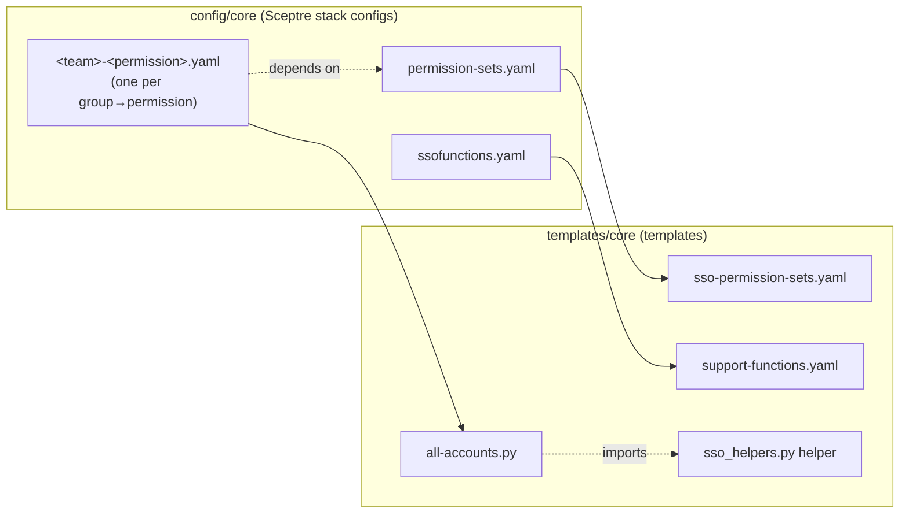
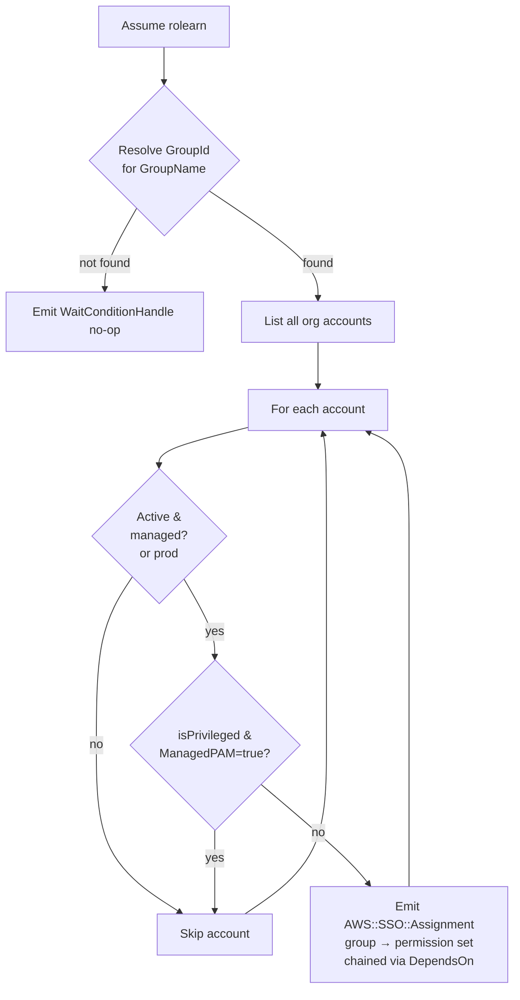

# Core Components & Common Assignments

This directory holds the **core** SSO components for your AWS Organization: the definitions of
every IAM Identity Center permission set, a supporting Lambda helper, and the "common" assignments
that grant Identity Center groups access across **all managed, active accounts** in the
organization.

These stacks are deployed by the
[`core-deployment.yml`](../../.github/workflows/core-deployment.yml) GitHub Actions workflow via the
sceptre-deploy/Sceptre pipeline. See the [top-level README](../../README.md) for how deployment is
triggered and configured.

## How it fits together

Permission sets must exist before assignments can reference them, so every assignment config
declares `core/permission-sets.yaml` as a dependency.

Each file in this directory is a Sceptre stack config. A config points at a template in
`templates/core/`, supplies its parameters, and declares dependencies so Sceptre applies them in
the right order. SSO instance values (`SSOINSTANCEID`, `SSOINSTANCEARN`) and the deployment role
(`AWS_ROLE`) are injected from the GitHub Environment as environment variables.

Common stack tags (`application: sso`, `role: org-prod`) are defined once in
[`config/config.yaml`](../config.yaml) under `stack_tags:` and **inherited** by every stack in
`core/`, `nonp/`, and `prod/` — no per-config include is needed.

## Base stacks

### `permission-sets.yaml` → `sso-permission-sets.yaml`

Defines all managed permission sets and, for each one, an SSM parameter under
`/platform/sso/permissionsets/org/<Name>` that stores the permission set's ARN. The assignment stacks
resolve these SSM parameters at deploy time, so this stack must exist first — every assignment
config lists it as a dependency.

Permission sets defined here include:

| Permission set        | Summary |
| --------------------- | ------- |
| `Legacy_BillingAdmin`     | Full billing / cost / marketplace / purchasing access (assigned to prod by default). |
| `Legacy_BillingReadOnly`  | Read-only billing and cost views. |
| `Legacy_PlatformAdmin`        | Break-glass `AdministratorAccess`. |
| `Legacy_IAMAdmin`         | Full IAM access. |
| `Legacy_DNSAdmin`         | Route 53 / CloudFront DNS management. |
| `Legacy_ProductAdmin`     | Admin with guardrail denies (billing, core services, regions, unencrypted EBS). |
| `Legacy_CloudAdmin`       | Common admin with denies on SSO/Org/ControlTower/IAM-user mutations. |
| `Legacy_CloudReadOnly`    | Read-only with billing-change denies. |
| `Legacy_SSMSessionUser`   | SSM Session Manager start/terminate plus read-only. |
| `Legacy_LabAdmin`         | Admin scoped for lab use with guardrail denies. |
| `Legacy_SecurityReadOnly` | Security audit read-only (denies reading secret/data values). |
| `Legacy_SecurityAdmin`    | Security Hub / audit admin with guardrail denies. |
| `Legacy_Developer`        | Read-only plus scoped write to dev/qa resources. |
| `Legacy_OperationsSupport`| Read-only plus scoped EC2/ASG/Route53/SSM operational actions. |

> The exact managed policies, inline statements, and customer-managed policy references are the
> source of truth in [`templates/core/sso-permission-sets.yaml`](../../templates/core/sso-permission-sets.yaml).

### `ssofunctions.yaml` → `support-functions.yaml`

Deploys a Lambda-backed CloudFormation custom resource that resolves an Identity Center group's
`GroupId` from its display name. It is used to look up group IDs when wiring assignments.

## Common assignment stacks

Every other config in this directory describes a single **group → permission set** assignment that
is fanned out across the whole organization. They all use the `core/all-accounts.py` template.

| Config file                              | Group | Permission set |
| ---------------------------------------- | ----- | -------------- |
| `finopsteam-billingadmin.yaml`           | `shared-group-01` | `BillingAdmin` |
| `opsteam-cloudadmin.yaml`                | `shared-group-02` | `CloudAdmin` (privileged) |
| `opsteam-cloudreadonly.yaml`             | `shared-group-02` | `CloudReadOnly` |
| `opsteamlimited-billingreadonly.yaml`    | `core-group-02` | `BillingReadOnly` |
| `opsteamlimited-cloudreadonly.yaml`      | `core-group-02` | `CloudReadOnly` |
| `operations-support.yaml`                | `core-group-01` | `OperationsSupport` |
| `team-security-securityreadonly.yaml`    | `core-group-03` | `SecurityReadOnly` |

Each config supplies `sceptre_user_data`:

- `GroupName` / `Permission` – the Identity Center group and the permission set (by SSM name).
- `SSMPrefix` – `/platform/sso/permissionsets/org`, where permission-set ARNs are published.
- `rolearn`, `SSOInstanceId`, `SSOInstanceArn` – injected from the environment.
- `isPrivileged` (e.g. `opsteam-cloudadmin.yaml`) – when `true`, accounts tagged
  `ManagedPAM=true` are skipped (their privileged access is managed elsewhere).

Common config keys:

- `dependencies:` – at minimum `core/permission-sets.yaml` (some also depend on a sibling
  assignment to serialize Identity Center API calls).
- `ignore:` – when `true`, Sceptre skips the stack during normal runs; flip to `false` to
  activate. All of the assignment stacks in this directory currently run with `ignore: false`.
- `on_failure:` – `ROLLBACK` or `DO_NOTHING` (e.g. `team-security-securityreadonly.yaml` uses
  `DO_NOTHING`).

## The assignment templates

### `all-accounts.py`

A [troposphere](https://github.com/cloudtools/troposphere) script run through Sceptre's
`sceptre_handler`. It:

1. Assumes `rolearn` and creates `identitystore` and `organizations` clients.
2. Lists every account in the organization and resolves the target group's `GroupId`.
3. For each **active** account that the org **manages** (excludes the ROOT and the unmanaged OUs
   listed in `sso_helpers.py`, with the prod accounts always included), emits an
   `AWS::SSO::Assignment` granting the group the permission set (ARN resolved from SSM).
4. Chains assignments with `DependsOn` so they are created serially, and emits a
   `WaitConditionHandle` no-op if the group can't be found.

When `isPrivileged` is set, accounts tagged `ManagedPAM=true` are skipped.

### `sso_helpers.py`

Helper module imported by `all-accounts.py`:

- `get_accounts` – paginates `organizations:ListAccounts`.
- `get_group_id` – resolves an Identity Center group's ID by display name.
- `is_account_active` – skips `SUSPENDED` accounts.
- `is_managed_account` – excludes accounts in the ROOT or in the `UNMANAGED_OUs` list.

### `support-functions.yaml`

The CloudFormation template behind `ssofunctions.yaml` (the group-lookup Lambda custom resource
described above).

## Adding or changing a common assignment

1. Copy an existing `<team>-<permission>.yaml`, set `GroupName` and `Permission`, and confirm the
   permission set exists in `sso-permission-sets.yaml` (it must publish an SSM parameter under
   `/platform/sso/permissionsets/org`).
2. Keep `core/permission-sets.yaml` as a dependency; add a sibling dependency if you need the
   assignment serialized after another.
3. Set `ignore: false` to activate it.
4. Merge per the workflow in the [top-level README](../../README.md) — `nonp` first, then
   `prod`.
