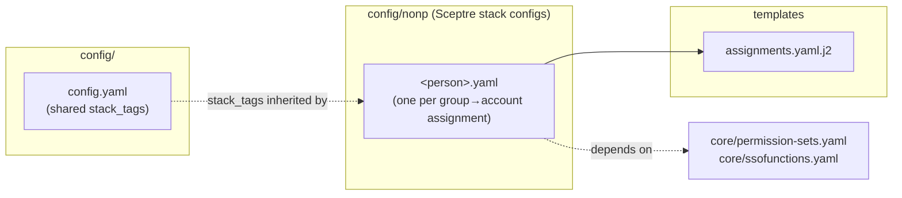

# Nonp Assignments

This directory is a separate **Sceptre StackGroup** for the nonp environment. Each config
grants an IAM Identity Center group a permission set in a **specific nonp account** (unlike the
`core/` assignments, which fan a group out across the whole organization).

These stacks are deployed by the
[`nonp-deployment.yml`](../../.github/workflows/nonp-deployment.yml) GitHub Actions
workflow via the sceptre-deploy/Sceptre pipeline. That workflow is **path-scoped**: it only runs when
files under `config/nonp/**` or [`templates/assignments.yaml.j2`](../../templates/assignments.yaml.j2)
change, so nonp changes deploy independently of `core/`. See the
[top-level README](../../README.md) for how deployment is triggered and configured.

## How it fits together

Each `*.yaml` file is a Sceptre stack config that points at the shared
[`assignments.yaml.j2`](../../templates/assignments.yaml.j2) template and supplies a list of
assignments. The configs depend on the `core/` group:

- `core/permission-sets.yaml` – publishes each permission set's ARN to SSM under
  `/platform/sso/permissionsets/org/<Name>`, which the template resolves at deploy time. Every config
  declares this dependency.
- `core/ssofunctions.yaml` – the Lambda-backed custom resource that resolves a group's `GroupId`
  from its display name. The nonp configs declare this dependency;
  `nonp-shared.yaml` does not (it depends on `core/permission-sets.yaml` only).

## Shared tags and parameters

- **Stack tags** (`application: sso`, `role: org-prod`) are defined once in
  [`../config.yaml`](../config.yaml) under `stack_tags:` and **inherited** by every stack (shared
  with the `core/` and `prod/` StackGroups).
- **CloudFormation parameters** are declared in each stack config's own `parameters:` block:
  `SSMPrefix`, `SSOInstanceArn` / `SSOInstanceId` (injected from the environment as
  `{{ environment_variable.SSOINSTANCEARN }}` / `{{ environment_variable.SSOINSTANCEID }}`), and
  `AssignmentFunction` (resolved from SSM via `!ssm /platform/sso/permissionsets/org/AssignmentsFunction`,
  the parameter published by `core/ssofunctions.yaml`).

> Earlier revisions shared these via `` /
> ``. That never worked — Sceptre roots the Jinja2 loader at each
> config file's own directory and Jinja2 rejects `..` path segments (`TemplateNotFound`).

## Assignment stacks

Each config provides `sceptre_user_data.Assignments` — a list where every entry has:

- `name` – the Identity Center group display name (resolved to a `GroupId` at deploy time).
- `account` – the target AWS account ID.
- `permission` – the permission set name (its ARN is resolved from SSM under `SSMPrefix`).

| Config file               | Group | Account | Permission set | Notes |
| ------------------------- | ----- | ------- | -------------- | ----- |
| `nonp-shared.yaml`    | several `example-nonp-*` groups | `100000000225`, `100000000226` | `CloudAdmin`, `SecurityReadOnly`, `BillingReadOnly`, `BillingAdmin`, `CloudReadOnly` | The shared nonp account assignments |

Common config keys:

- `template_path: assignments.yaml.j2` – the shared assignment template.
- `dependencies:` – `core/permission-sets.yaml` (all configs), plus `core/ssofunctions.yaml` where
  the assignment function is needed.
- `on_failure: ROLLBACK` – CloudFormation rollback behaviour on a failed create.
- `obsolete: True` – marks a stack as retired so it is skipped during normal runs.

## The template: `assignments.yaml.j2`

A CloudFormation template with embedded Jinja2 (rendered by Sceptre before submission). For each
entry in `Assignments` it emits:

1. A `Custom::CustomRunner` resource (`RUN<id>`) that calls the `AssignmentFunction` Lambda to
   resolve the group's `GroupId` from its `name`.
2. An `AWS::SSO::Assignment` granting the group (`PrincipalId` from the runner) the permission set
   (`PermissionSetArn` resolved from SSM via `SSMPrefix` + `permission`) in the target `account`.

Assignments are chained with `DependsOn` so they are created serially, and a `WaitConditionHandle`
(`NullResource`) seeds the chain. Logical IDs are built from `permission + account + group token`
to stay unique and within CloudFormation's 255-char limit.

## Adding a nonp assignment

1. Copy an existing `<person>.yaml`, set the `name` (group), `account`, and `permission` under
   `sceptre_user_data.Assignments`. To add multiple assignments in one stack, append more list
   entries (see `nonp-shared.yaml`).
2. Confirm the permission set exists in
   [`core/permission-sets.yaml`](../core/permission-sets.yaml) so its ARN is published to SSM.
3. Keep both `core/` dependencies and the `parameters:` block.
4. Merge per the workflow in the [top-level README](../../README.md) — `nonp` first, then
   `prod`. Only changes under `config/nonp/**` (or `templates/assignments.yaml.j2`) trigger
   this pipeline.
