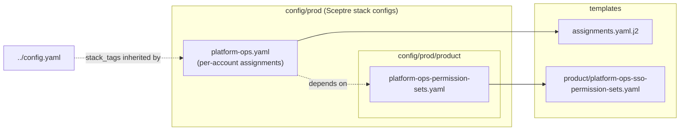

# Prod (Production) Assignments

This directory is a **Sceptre StackGroup** for the **prod / production** organization. Like
[`nonp/`](../nonp/README.md), each config grants IAM Identity Center groups a permission set
in **specific named accounts** (audit, log-archive, finops, management, shared-services, monitoring,
platform-ops, …) — as opposed to the `core/` assignments, which fan a group out across *every* managed
account in the org.

It also carries a [`product/`](product/README.md) sub-group that defines **product-specific
permission sets** (e.g. `Mgmt-ProductSupport`, `Shared-ProductSupport`, `Shared-Role02`) consumed by
the assignments here.

> **Terminology:** the StackGroup name `prod` is distinct from (though aligned with) the GitHub
> **Environment** `prod` and the `prod` git branch. This folder is the *set of production-account
> assignments*; the GitHub Environment supplies the production AWS role and SSO instance values.

## How it fits together

`platform-ops.yaml` points at the shared [`assignments.yaml.j2`](../../templates/assignments.yaml.j2)
template and supplies a list of `name` (group) → `account` → `permission` entries. It depends on
[`product/platform-ops-permission-sets.yaml`](product/platform-ops-permission-sets.yaml) so the
product-specific permission sets exist (and are published to SSM) before they are referenced. The
standard permission sets (`CloudAdmin`, `PlatformAdmin`, `BillingAdmin`, …) are resolved from the same
`/platform/sso/permissionsets/org` SSM namespace published by
[`core/permission-sets.yaml`](../core/permission-sets.yaml), which must already be deployed.

## Shared tags and parameters

- **Stack tags** (`application: sso`, `role: org-prod`) are defined once in
  [`../config.yaml`](../config.yaml) under `stack_tags:` and **inherited** by every stack in core,
  nonp, and prod.
- **CloudFormation parameters** are declared in each stack config's own `parameters:` block.
  `platform-ops.yaml` (assignment template) supplies `SSMPrefix` (`/platform/sso/permissionsets/org`),
  `SSOInstanceArn` / `SSOInstanceId` (injected from the environment), and `AssignmentFunction`
  (resolved from SSM via `!ssm /platform/sso/permissionsets/org/AssignmentsFunction`, published by
  `core/ssofunctions.yaml`). The permission-set stack under `product/` omits `AssignmentFunction`
  because its template does not declare it.

> Earlier revisions shared these via `` /
> ``. That never worked — Sceptre roots the Jinja2 loader at each
> config file's own directory and Jinja2 rejects `..` path segments (`TemplateNotFound`).

## Assignment stack: `platform-ops.yaml`

`sceptre_user_data.Assignments` is a list where every entry has a `name` (group display name,
resolved to a `GroupId` at deploy time), an `account` (target AWS account ID), and a `permission`
(permission-set name, resolved to an ARN from SSM under `SSMPrefix`). The current assignments, by
account:

| Account              | ID             | Groups → permission sets |
| -------------------- | -------------- | ------------------------ |
| audit                | `100000000002` | `CloudAdmin` |
| log-archive          | `100000000003` | `CloudAdmin` |
| finops               | `100000000004` | `CloudAdmin` |
| prod-account         | `100000000005` | `CloudAdmin`, `PlatformAdmin`, `BillingReadOnly`, `BillingAdmin`, `CloudReadOnly`, `DNSAdmin` |
| management           | `100000000006` | `CloudAdmin`, `IAMAdmin`, `PlatformAdmin`, `CloudReadOnly`, `SSMSessionUser`, `Mgmt-ProductSupport` |
| shared-services-nonp | `100000000007` | `CloudAdmin`, `PlatformAdmin`, `CloudReadOnly`, `Shared-ProductSupport`, `SSMSessionUser` |
| shared-services-prod | `100000000001` | `CloudAdmin`, `PlatformAdmin`, `CloudReadOnly`, `Shared-ProductSupport`, `Shared-Role02`, `SSMSessionUser` |
| monitoring-nonp          | `100000000008` | `CloudAdmin`, `CloudReadOnly`, `SSMSessionUser` |
| monitoring-prod          | `100000000009` | `CloudAdmin`, `CloudReadOnly`, `SSMSessionUser` |
| platform-ops              | `100000000010` | `CloudAdmin`, `PlatformAdmin`, `CloudReadOnly` |

> The `*-ProductSupport` and `*BBMigrationUser` permission sets come from the
> [`product/`](product/README.md) sub-group; the rest are the standard sets from
> [`core/permission-sets.yaml`](../core/permission-sets.yaml). A few entries are commented out in the
> source (e.g. `network-ops`, `organizationsreadonly`) — those accounts/permission sets are not yet
> provisioned. The config file is the source of truth.

Common config keys:

- `template_path: assignments.yaml.j2` – the shared assignment template.
- `dependencies:` – `prod/product/platform-ops-permission-sets.yaml`.
- `on_failure: ROLLBACK` – CloudFormation rollback behaviour on a failed create.

## The template: `assignments.yaml.j2`

The same CloudFormation-with-embedded-Jinja template used by the nonp assignments. For each
`Assignments` entry it emits a `Custom::CustomRunner` that resolves the group's `GroupId` via the
`AssignmentFunction` Lambda, then an `AWS::SSO::Assignment` granting that group the permission set
(ARN resolved from SSM via `SSMPrefix` + `permission`) in the target `account`. Assignments are
chained with `DependsOn` so they are created serially. See
[`nonp/README.md`](../nonp/README.md#the-template-assignmentsyamlj2) for the full description.

## Deployment

These stacks are deployed by the
[`prod-deployment.yml`](../../.github/workflows/prod-deployment.yml) GitHub Actions workflow via
the same a shared **sceptre-deploy**/Sceptre pipeline as `core/` and `nonp/`. It is **path-scoped**
to `config/prod/**`, `templates/product/**`, and
[`templates/assignments.yaml.j2`](../../templates/assignments.yaml.j2), targets the `prod`
StackGroup, and binds to the GitHub **Environment** resolved from the branch (`prod` for
production) — which supplies `AWS_ROLE`, `SSOINSTANCEID`, and `SSOINSTANCEARN`. See the
[top-level README](../../README.md) for the shared deployment model.

## Adding a prod assignment

1. Add an entry to `sceptre_user_data.Assignments` in `platform-ops.yaml` with the `name` (group),
   `account`, and `permission`.
2. Confirm the permission set is published to SSM under `/platform/sso/permissionsets/org` — either by
   [`core/permission-sets.yaml`](../core/permission-sets.yaml) (standard sets) or by
   [`product/platform-ops-permission-sets.yaml`](product/platform-ops-permission-sets.yaml) (product sets,
   adding it there first if new).
3. Keep the `prod/product/platform-ops-permission-sets.yaml` dependency and the `parameters:` block.
4. Merge per the workflow in the [top-level README](../../README.md) — `nonp` first, then
   `prod`.
