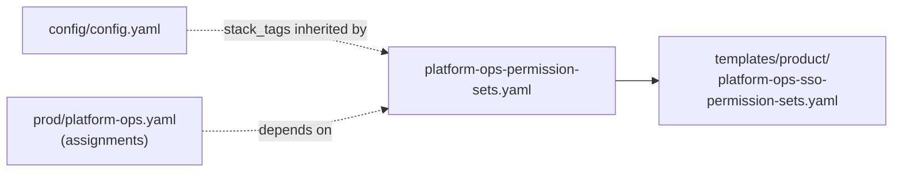

# Product-Specific Permission Sets

This is a sub-group of the [`prod/`](../README.md) StackGroup that defines **product-specific IAM
Identity Center permission sets** — sets that only certain product/account teams need, kept separate
from the org-wide standard sets in [`core/permission-sets.yaml`](../../core/permission-sets.yaml).

Each set is published to SSM under `/platform/sso/permissionsets/org/<Name>` (the `SSMPrefix` declared in
this stack's `parameters:` block), so the assignment stacks — notably
[`prod/platform-ops.yaml`](../platform-ops.yaml) — can resolve their ARNs by name at deploy time.

## How it fits together



## The stack config: `platform-ops-permission-sets.yaml`

```yaml
template_path: product/platform-ops-sso-permission-sets.yaml
on_failure: DO_NOTHING
parameters:
    SSMPrefix: "/platform/sso/permissionsets/org"
    SSOInstanceArn: {{ environment_variable.SSOINSTANCEARN }}
    SSOInstanceId: {{ environment_variable.SSOINSTANCEID }}
```

- **`template_path`** – [`templates/product/platform-ops-sso-permission-sets.yaml`](../../../templates/product/platform-ops-sso-permission-sets.yaml),
  relative to `templates/`.
- **`on_failure: DO_NOTHING`** – leaves a failed create in place for inspection rather than rolling
  back.
- **`parameters`** – `SSMPrefix`, `SSOInstanceArn`, `SSOInstanceId`. Note this template does **not**
  declare `AssignmentFunction` (unlike the assignment template), so that parameter is intentionally
  omitted — CloudFormation rejects undeclared parameters.
- **Stack tags** (`application: sso`, `role: org-prod`) are inherited from
  [`config/config.yaml`](../../config.yaml), not included per file.

> Earlier revisions used `` / `` here.
> That never worked — Sceptre roots the Jinja2 loader at this file's own directory, so neither the
> bare filename (no such file here) nor a `../../` path (Jinja2 rejects `..`) could resolve.

## Permission sets defined

The template behind this stack,
[`templates/product/platform-ops-sso-permission-sets.yaml`](../../../templates/product/platform-ops-sso-permission-sets.yaml),
creates each permission set plus an `AWS::SSM::Parameter` storing its ARN under
`${SSMPrefix}/<name>`:

| Permission set            | SSM name (`/platform/sso/permissionsets/org/…`) | Summary |
| ------------------------- | ------------------------------------------- | ------- |
| `Mgmt-ProductSupport`  | `Mgmt-ProductSupport` | `ReadOnlyAccess` plus the customer-managed `ProductSupportRolePolicy-additional` (path `/platform/`). 4-hour sessions. Used in the management account. |
| `Shared-ProductSupport`    | `Shared-ProductSupport`   | Same shape as above, for the shared-services accounts. 4-hour sessions. |
| `Shared-Role02`   | `Shared-Role02`  | Inline policy scoped to SSM Session Manager / GUI Connect on instances tagged `application=bbmigration`, plus EC2 read and session self-management. 8-hour sessions. Used in shared-services-prod. |
| `Shared-Role01`     | `Shared-Role01`    | **Temporary, expires 2026-09-30.** CodeArtifact / ECR / artifact-and-state S3 / KMS / scoped IAM for the JFrog Artifactory to AWS CodeArtifact migration (TICKET-0000). Inline policy with a terminal `DateGreaterThan` Deny. 4-hour sessions. Used in shared-services-prod. |

> The exact managed policies, inline statements, and customer-managed policy references are the
> source of truth in the template, not this table.

## Adding a product permission set

1. Add the `AWS::SSO::PermissionSet` and its companion `AWS::SSM::Parameter`
   (`Name: !Sub "${SSMPrefix}/<name>"`) to
   [`platform-ops-sso-permission-sets.yaml`](../../../templates/product/platform-ops-sso-permission-sets.yaml).
2. Reference it from an assignment by `permission: "<name>"` in
   [`prod/platform-ops.yaml`](../platform-ops.yaml) (or another assignment stack), keeping the dependency
   on this stack.
3. Merge per the workflow in the [top-level README](../../../README.md) — `nonp` first, then
   `prod`.
